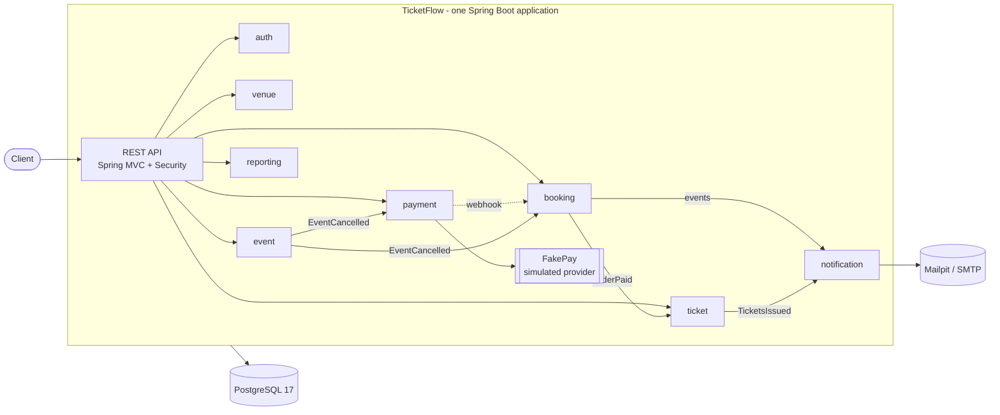

# TicketFlow

[](https://github.com/ioanantonio2003/TicketFlow/actions/workflows/ci.yml)

Ticket booking platform for events with numbered seats. Organizers create venues and events with prices per
section; customers pick seats, **hold** them for 10 minutes, pay through a simulated provider and receive tickets
with QR codes. The hard part is concurrency: two customers can never hold or buy the same seat. It is solved with
**one conditional `UPDATE` in PostgreSQL** and proven by a concurrent integration test and a k6 load test
(1000 customers racing for 100 seats: exactly 100 winners, 0 double bookings).

## Features

- **Accounts**: registration, login with short-lived JWT access tokens and rotating refresh tokens with reuse detection;
  roles `CUSTOMER`, `ORGANIZER`, `ADMIN`.
- **Venues and events**: venues with sections, rows and seats; events with a price per section; publishing generates
  the event seats; public search, event details and a live seat map.
- **Booking**: hold up to 6 seats per event for 10 minutes (all or nothing), automatic release of expired holds,
  cancellation.
- **Payments**: simulated provider (FakePay) behind HTTP with signed webhooks; idempotent checkout (`Idempotency-Key`);
  idempotent webhook handling.
- **Tickets**: unguessable ticket codes, QR code images, one-time validation at the entrance by the event's organizer.
- **Refunds and cancellation**: refund until 24 h before the event; cancelling an event refunds every paid order.
- **Emails** (Mailpit in development): tickets, refunds, cancellations.
- **Reporting** for organizers: occupancy, revenue, orders by status, sales per section.
- **API docs** with Swagger UI (development only).

## Architecture

A modular monolith, package by feature. A feature uses another one only through its public service or through
events; entities never cross feature boundaries.



Why a modular monolith and why seats are held in the database: see the [ADRs](#decisions-adrs).

## Tech stack

Java 21 (virtual threads), Spring Boot 4, Spring Security 7 (OAuth2 resource server, JWT HS256), Spring Data JPA /
Hibernate 7, PostgreSQL 17, Flyway, MapStruct, springdoc-openapi, ZXing (QR codes), JUnit 5 + Testcontainers 2,
Docker / Docker Compose, GitHub Actions, k6.

## Run it

Requirements: Docker (and JDK 21 only for development).

### Everything in containers (one command)

```bash
cp .env.example .env                      # then put your own secrets in .env
docker compose --profile app up -d --build
curl localhost:8080/actuator/health       # {"status":"UP", ...}
```

The application is on `http://localhost:8080`, Mailpit (the emails) on `http://localhost:8025`. The first
administrator is created from `ADMIN_EMAIL` / `ADMIN_PASSWORD`. The production profile has no demo data and no
Swagger UI.

### Development (application on your machine, demo data, Swagger UI)

```bash
docker compose up -d                      # PostgreSQL and Mailpit
./mvnw spring-boot:run -Dspring-boot.run.profiles=dev
```

Swagger UI: `http://localhost:8080/swagger-ui/index.html` (log in with `POST /api/auth/login`, press **Authorize**,
paste the access token). The `dev` profile creates demo users and events:

| User | Password | Role |
|---|---|---|
| `admin@ticketflow.local` | `admin12345` | ADMIN |
| `organizer@ticketflow.local` | `organizer123` | ORGANIZER |
| `customer@ticketflow.local` | `customer123` | CUSTOMER |

These credentials exist only in the `dev` profile.

## Demo web app

A small React + Vite + TypeScript app in [`frontend/`](frontend) covers every feature for the three roles: event list
with filters, seat map, hold with countdown, simulated payment, tickets with QR codes, refunds, and the organizer
screens (venues, events, prices, publish, cancel, statistics, ticket scanner) and an admin page.

```bash
# with the application running in the dev profile (demo data and users, see below)
cd frontend && npm install && npm run dev      # http://localhost:5173, the API is proxied to localhost:8080
```

With `docker compose --profile app up -d --build` the same app is served by nginx on `http://localhost:5173`.
The access token is kept in memory and the refresh token in `sessionStorage`; there is no live seat push, the seat map
refreshes every 5 seconds.

## Example: from hold to ticket

```bash
# 1. log in and keep the access token
T=$(curl -s localhost:8080/api/auth/login -H 'Content-Type: application/json' \
      -d '{"email":"customer@ticketflow.local","password":"customer123"}' | jq -r .accessToken)

# 2. look at the seats of event 1 and hold two of them (ids from the seat map)
curl -s localhost:8080/api/events/1/seats
ORDER=$(curl -s -X POST localhost:8080/api/orders -H "Authorization: Bearer $T" \
      -H 'Content-Type: application/json' -d '{"eventId":1,"seatIds":[1,2]}' | jq -r .id)

# 3. start the payment (the Idempotency-Key makes retries safe), then "pay" at the simulated provider
PAY=$(curl -s -X POST localhost:8080/api/orders/$ORDER/checkout -H "Authorization: Bearer $T" \
      -H "Idempotency-Key: $(uuidgen)" | jq -r .providerPaymentId)
curl -s -X POST "localhost:8080/fakepay/payments/$PAY/complete?outcome=success"

# 4. the order is PAID and the tickets exist
curl -s localhost:8080/api/orders/$ORDER -H "Authorization: Bearer $T"
curl -s localhost:8080/api/tickets -H "Authorization: Bearer $T"
curl -s localhost:8080/api/tickets/1/qr -H "Authorization: Bearer $T" -o ticket.png
```

Main endpoints (all under `/api`, details in Swagger UI): `auth/*`, `venues`, `events`, `events/{id}/seats`,
`orders` (+ `/{id}/cancel`, `/checkout`, `/refund`), `tickets` (+ `/{id}/qr`, `/validate`), `organizer/events/{id}/stats`,
`organizer/stats`, `events/{id}/cancel`.

## Tests

```bash
./mvnw verify    # unit, slice and integration tests (Docker must be running: Testcontainers starts PostgreSQL)
```

About 450 tests: unit tests with Mockito, `@WebMvcTest` for controllers and security rules, `@DataJpaTest` against a
real PostgreSQL for the queries, and end-to-end `*IT` tests (booking flow, payments with real HTTP and signed
webhooks, refunds and emails, tickets, reporting). The concurrency tests start up to 200 virtual threads at the
same moment and check invariants such as "no seat is in two orders"; removing the `status = 'AVAILABLE'` condition
from the `UPDATE` makes them fail, which shows they test what they claim to test.

## Load test: 1000 customers, 100 seats

`loadtest/hold-race.js` (k6) creates an event with exactly 100 seats, registers 1000 customers and lets all of them
try to hold a random seat at the same moment. Then `scripts/verify-no-double-booking.sql` checks the database.

```bash
docker run --rm -i --network ticketflow_default -e BASE_URL=http://app:8080 \
    -e ADMIN_EMAIL=admin@example.com -e ADMIN_PASSWORD=... grafana/k6 run - < loadtest/hold-race.js
docker compose exec -T postgres psql -U ticketflow -d ticketflow -v event_id=<id from the k6 output> \
    -f - < scripts/verify-no-double-booking.sql
```

Result (laptop, 12 cores, application and PostgreSQL in Docker, k6 in the same Docker network):

| | |
|---|---|
| Requests that held a seat (`201`) | **100** (one per seat) |
| Requests refused because the seat was taken (`409`) | **900** |
| Other answers, 5xx | **0** |
| Request duration, median / p95 / max | 100 ms / 0.9 s / 1.6 s |
| Whole race (1000 simultaneous requests) | about 2 s |
| Seats in more than one active order / held seats without an order item / orphan orders | **0 / 0 / 0** |

Run through Docker Desktop's `host.docker.internal` instead, 1 or 2 of the 1000 connections sometimes timed out
(the client could not connect, the server never answered with an error); that is the host port forwarding of
Docker Desktop, not the application, so the numbers above use the Docker network.

## Configuration

Everything is configured with environment variables in the `prod` profile (secrets have no defaults).

| Variable | Purpose |
|---|---|
| `DB_URL`, `DB_USERNAME`, `DB_PASSWORD` | PostgreSQL (set by `compose.yaml` for the `app` service) |
| `JWT_SECRET` | signs access tokens, at least 32 random characters |
| `FAKEPAY_WEBHOOK_SECRET` | signs the payment webhooks, at least 32 random characters |
| `ADMIN_EMAIL`, `ADMIN_PASSWORD` | first administrator, created on startup if none exists |
| `PUBLIC_BASE_URL` | where the application is reachable (used by the simulated provider), default `http://localhost:8080` |
| `CORS_ALLOWED_ORIGINS` | browser origins allowed to call the API |
| `MAIL_HOST`, `MAIL_PORT` | SMTP server (Mailpit in compose) |

Business settings live under `app.*` in `application.yml`: hold duration (10 min), maximum seats per customer and
event (6), refund deadline (24 h), expiry job interval and batch size.

## Decisions (ADRs)

- [0001 Seat holding with one conditional UPDATE](docs/adr/0001-seat-holding-with-conditional-update.md)
- [0002 Payment idempotency and webhooks](docs/adr/0002-payment-idempotency-and-webhooks.md)
- [0003 Modular monolith](docs/adr/0003-modular-monolith.md)
- [0004 JWT with rotating refresh tokens](docs/adr/0004-jwt-with-rotating-refresh-tokens.md)

## Limitations

- Payments are simulated; a real provider would need its own client and credentials.
- Side effects between features (emails, tickets, refunds on event cancellation) run in the same application after the
  database commit. If the process dies at that moment they are not retried; a transactional outbox would fix that.
- Seats are not pushed to browsers live: the web app polls the seat map every 5 seconds.
